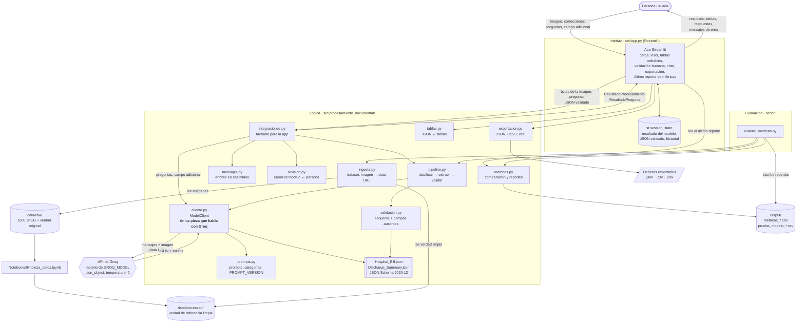

# ARCHITECTURE.md — Sistema de procesamiento documental mediante IA

Este documento describe las piezas del sistema, de qué se responsabiliza cada
una y cómo circula la información entre ellas. Las razones de cada elección
están en los ADRs de [`decisions/`](decisions/), y lo que hace cada
funcionalidad, en [`specs/`](specs/).

## Diagrama

Las flechas indican quién llama a quién o quién lee o escribe un dato. Solo
`cliente.py` tiene una flecha hacia Groq: ni la app ni el script llaman a la
API directamente.

## Componentes

| Componente | Responsabilidad | Recibe | Produce |
|---|---|---|---|
| **App Streamlit** (`src/app.py`) | Solo la presentación. Carga la imagen, la muestra, lanza el procesamiento, enseña tipo, validación y entidades en tablas editables, deja marcar el resultado como validado, ofrece el chat, el campo adicional, las descargas y el último reporte de métricas. Lee `.env` al arrancar. | Imagen JPEG/PNG subida o elegida del dataset, ediciones en tablas, preguntas. | Llamadas a `integraciones.py`, `tablas.py` y `exportacion.py`. Pantallas y descargas. |
| **Estado de sesión** (`st.session_state`) | Guarda por documento el resultado del modelo, el último JSON validado por la persona, los campos adicionales y el historial del chat. No hay base de datos: todo vive solo durante la sesión. | Lo que escribe la app. | Lo que lee la app al repintarse. |
| **Integraciones** (`integraciones.py`) | Fachada entre la interfaz y la lógica. `procesar_documento()` convierte la imagen y llama a la tubería. `responder_pregunta()` y `extraer_campo_adicional()` llaman al cliente y comprueban la respuesta. Convierte los fallos en `ErrorProcesamiento` con mensaje en castellano. | Bytes de la imagen, pregunta, historial, JSON validado. | `ResultadoProcesamiento` (tipo, entidades, validación, latencias, error) y `ResultadoPregunta` (respuesta, evidencias, cambios). |
| **Tubería** (`pipeline.py`) | Procesa un documento en serie: clasifica, extrae con el esquema del tipo y valida. Registra en qué etapa falla (`classification` o `extraction`). La usan la app y el script, así que los dos procesan igual. | `ModelClient` y la imagen como *data URL*. | `DocumentResult`. |
| **Cliente del modelo** (`cliente.py`) | La única pieza que habla con Groq. Lee `GROQ_API_KEY` y `GROQ_MODEL` del entorno, pide `json_object` con `temperature=0`, reintenta los fallos transitorios (hasta 5 intentos, respetando `retry-after`) y, si la respuesta no cumple el esquema, le devuelve al modelo sus errores para que la corrija (hasta 3 llamadas). Mide latencia y tokens. | Mensajes de `prompts.py` y el esquema que debe cumplir la respuesta. | `ModelResponse` (contenido, latencia, tokens, intentos) o `ModelError` (etapa, código HTTP, código de Groq). |
| **Prompts** (`prompts.py`) | Construye las peticiones: clasificación (`bill`, `discharge_summary`), extracción con el esqueleto del esquema, preguntas y campo adicional. Fija `PROMPT_VERSION` para poder comparar evaluaciones. | Imagen, tipo documental, contexto JSON, pregunta. | Lista de mensajes y esquema de la respuesta. |
| **Esquemas** (`src/Hospital_Bill.json`, `src/Discharge_Summary.json`) | Definen los campos de cada tipo, con los mismos campos que la verdad limpia. Ver el [ADR de esquemas](decisions/esquemas-extraccion-documental.md). | — | JSON Schema Draft 2020-12. |
| **Validación** (`validacion.py`) | Comprueba que el JSON de extracción es válido según su esquema y lista los campos ausentes (`null`). | Tipo documental y texto JSON. | `ValidationResult` (válido, errores, campos ausentes, datos). |
| **Mensajes de error** (`mensajes.py`) | Traduce cada fallo, según su etapa, el código HTTP y el código de error de Groq, a qué ha pasado y qué hacer, en castellano. El texto técnico se conserva aparte. | Etapa, tipo de error, código HTTP y código de Groq. | `UserMessage`. |
| **Revisión** (`revision.py`) | Calcula qué campos cambió la persona respecto a lo que extrajo el modelo, para que el chat lo diga. Los cambios no se envían a Groq. | JSON del modelo y JSON validado. | Lista de `EntityChange`. |
| **Tablas** (`tablas.py`) | Convierte el JSON en las tablas que se editan en la app y las tablas editadas de vuelta a JSON, validándolo contra el esquema. | Tipo documental y JSON o tablas. | `DataFrame` por sección o JSON y su validación. |
| **Exportación** (`exportacion.py`) | Genera en memoria los ficheros de descarga del resultado corregido. | Tipo documental y entidades. | Bytes de `.json`, `.csv` y `.xlsx`. |
| **Ingesta** (`ingesta.py`) | Lee las imágenes de `data/raw/` con su verdad limpia de `data/processed/`, toma muestras reproducibles (semilla 42) y convierte imágenes a *data URL*. | Rutas del dataset. | Lista de `Document` y *data URLs*. |
| **Métricas** (`metricas.py`) | Compara la extracción con la verdad limpia campo a campo, resume los reportes y localiza el último de `output/`. | JSON de referencia y predicho, CSV de `output/`. | `ExtractionMetrics`, `MetricsSummary`, `MetricsReport`. |
| **Evaluación** (`script/evaluar_metricas.py`) | Procesa una muestra del dataset con la misma tubería que la app, llamando a Groq una vez por documento, y guarda métricas, tiempos, tokens y coste. | Muestra de `ingesta.py`, precios por millón de tokens. | `output/metricas_*.csv` y `output/prueba_modelo_*.csv`. |
| **Limpieza de la verdad** (`Notebooks/limpieza_datos.ipynb`) | Quita de la verdad original los campos que no se ven en las imágenes de su tipo. Se ejecuta una vez y cada vez que cambia un esquema. | CSV de `data/raw/`, que no se modifica. | CSV de `data/processed/`. |
| **API de Groq** (externa) | Ejecuta el modelo multimodal. | Mensajes con la imagen y el prompt. | Objeto JSON y uso de tokens, o un error HTTP. |

## Flujo entre componentes

### 1. Procesar un documento ([`prototipo-streamlit`](specs/prototipo-streamlit.md), [`validacion-extraccion`](specs/validacion-extraccion.md))

1. La persona sube una imagen o elige una del dataset. La app pasa sus bytes a
   `integraciones.procesar_documento()`.
2. Integraciones la convierte en *data URL* (`ingesta.image_to_data_url`) y
   llama a `pipeline.process_document()`.
3. La tubería pide al cliente la **clasificación**. El cliente envía a Groq la
   imagen con el prompt de `prompts.py` y recibe `{"document_type": ...}`.
4. Con el tipo, la tubería pide la **extracción**. El cliente envía la imagen
   con el esqueleto del esquema de ese tipo. Si la respuesta no cumple el
   esquema, le devuelve al modelo sus errores para que la corrija.
5. `validacion.py` comprueba el JSON final y lista los campos ausentes.
6. La app guarda el `ResultadoProcesamiento` en la sesión y lo muestra en
   tablas editables (`tablas.entities_to_tables`).
7. Si una llamada falla, el cliente lanza `ModelError` con la etapa y los
   códigos de error. La app muestra el mensaje de `mensajes.py` y deja plegado
   el texto técnico.

### 2. Corregir, validar y exportar ([`edicion-exportacion`](specs/edicion-exportacion.md))

1. La persona edita las tablas. `tablas.tables_to_entities()` las devuelve a
   JSON y `tablas.validate_tables()` las valida con el mismo esquema.
2. Al marcar el resultado como validado, la app guarda ese JSON en la sesión
   como «último JSON validado», junto al original del modelo.
3. Las descargas llaman a `exportacion.to_json_bytes`, `to_csv_bytes` y
   `to_excel_bytes` con el JSON validado. Los ficheros se generan en memoria y
   no se guardan en el servidor.

### 3. Preguntar sobre el documento ([`consulta-documento`](specs/consulta-documento.md))

1. La app llama a `integraciones.responder_pregunta()` con la pregunta, el
   historial reciente y el último JSON validado (o el del modelo si no hay
   ninguno validado).
2. `revision.entity_changes()` calcula qué cambió la persona. Esos cambios se
   quedan en Python: no se envían a Groq.
3. El cliente envía a Groq el JSON, la pregunta y el historial, **sin la
   imagen**. Groq devuelve una intención y rutas JSON candidatas, no valores.
4. Integraciones comprueba que las rutas existen, lee sus valores del JSON y
   redacta la respuesta. Si usa un dato corregido, lo dice e indica lo que
   había extraído el modelo. Si la pregunta es ambigua o falta el dato, pide
   aclaración. Si la pregunta no trata del documento, la rechaza. El chat no
   calcula ni deduce valores.

**Campo adicional.** `extraer_campo_adicional()` sí vuelve a enviar la imagen a
Groq. El valor se guarda en `additional_fields`, separado de `entities`, para no
romper el esquema.

### 4. Evaluar el modelo ([`evaluacion-metricas`](specs/evaluacion-metricas.md))

1. `limpieza_datos.ipynb` genera la verdad limpia en `data/processed/` a partir
   de `data/raw/`.
2. `evaluar_metricas.py` toma una muestra con `ingesta.sample_documents()`
   (12 facturas y 12 informes, semilla 42) y procesa cada imagen con la misma
   `pipeline.process_document()` que la app.
3. `metricas.compare_extraction()` compara cada resultado con su verdad limpia.
   El script escribe en `output/` un CSV de métricas y otro de la prueba del
   modelo (clasificación, JSON válidos, latencia, tokens y coste).
4. La app lee el último reporte con `metricas.load_latest_metrics()` y lo
   muestra. No vuelve a evaluar.

## Decisiones que dan forma a la arquitectura

| ADR | Efecto en la arquitectura |
|---|---|
| [Inferencia con la API de Groq](decisions/modelo-via-api-groq.md) | El modelo es un servicio externo detrás de un único cliente. El esquema se valida en el cliente, no en Groq. |
| [Esquemas de extracción documental](decisions/esquemas-extraccion-documental.md) | Un esquema por tipo, que comparten cliente, validación, tablas, exportación y evaluación. Por eso existe la verdad limpia. |
| [Interfaz en Streamlit](decisions/interfaz-streamlit.md) | La app es una capa fina sobre `src/`, de modo que el script de evaluación ejecuta el mismo código. |
| [Ruff como linter y formateador](decisions/linter-ruff.md) | Un único estilo y un único comando de comprobación en todo `src/`, `script/` y `tests/`. |
| [Configuración de los asistentes de IA](decisions/configuracion-asistentes.md) | Dónde leen las reglas del repositorio los asistentes que lo modifican. |
